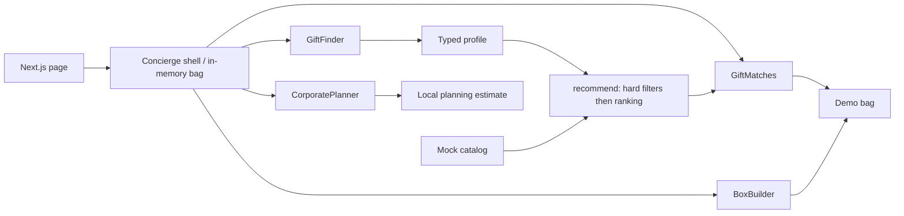
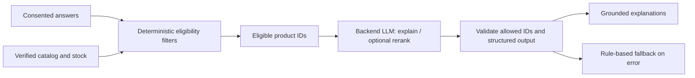

# Architecture & production integration

## Current prototype

`app/page.tsx` renders the client concierge. `Concierge` owns the finder profile, pathway, native modal dialog and bag. Each pathway is a separate component. `GiftArt` draws original vector compositions. `catalog.ts` defines typed products, profiles, preferences and CAD formatting. `recommendations.ts` is a pure domain function, independent of React, Next.js and Shopify. The app can prerender as a static page; no server-side customer data processing occurs.

Finder state and bag persist only within the mounted page. Builder and corporate drafts reset when leaving those pathways. Bag keys merge identical ready-made products and custom boxes with the same item composition. Notes are deliberately not carried into the bag. Prices exclude tax and shipping. Corporate recipient count is constrained by HTML form validation to 5–1,000. Multiple-address delivery is a planning selection, not an implemented fulfillment service.

### Rules, explicitly

1. Exclude every product over the chosen budget.
2. Exclude products conflicting with any selected preference.
3. Score +4 for each overlapping interest, +2 for a supported occasion.
4. Break ties by lower price, then product ID. Return at most three.
5. Explain only actual overlaps, actual occasion matches and budget eligibility.

Recipient is context only. There is no AI, embeddings, randomness, demographic inference or hidden tracking. With no overlaps, suggestions are budget-compatible discovery options, not claims of personal fit. No-match results preserve constraints and offer budget adjustment or a custom box. Allergy requirements must be verified by product metadata and merchant review in production; never use an LLM to guarantee safety.

## Shopify integration options

| Option                  | Fit                     | Implementation                                                                                                                                                                                                                      |
| ----------------------- | ----------------------- | ----------------------------------------------------------------------------------------------------------------------------------------------------------------------------------------------------------------------------------- |
| Theme app extension     | Recommended first pilot | Package the finder as an embeddable React widget in an app block, using the merchant's existing theme and checkout. Reuse domain logic, extract Next-specific routing. Respect theme styles, CSP and accessible modal interactions. |
| Headless storefront     | Broader redesign        | Use Next.js or Shopify Hydrogen with Storefront API catalog queries and Cart API. Route to Shopify's returned `checkoutUrl`. Higher responsibility for SEO, consent, caching and analytics.                                         |
| Shopify app + app proxy | Server-side concierge   | A merchant-installed app manages normalized catalog data, corporate requests and an optional LLM endpoint. A signed app-proxy request connects the storefront to that backend. Verify signatures and rate-limit requests.           |

Production implementation must consult the current Shopify API documentation and supported API version. No API compatibility has been verified by this offline demo.

### Catalog and cart boundaries

Introduce a `CatalogProvider` adapter that returns the existing product shape plus **verified Shopify product/variant IDs**, actual prices/currency, inventory eligibility, images with usage rights, product URLs and structured metafields for interests, occasions and exclusions. Do not infer exclusion metadata from marketing prose. Store money in minor units for production and respect Markets currency. Refresh through Shopify webhooks and short-lived caches; invalidate on product/inventory updates. Use Admin API only on a secured backend with minimum scopes. Tokens must never be committed or exposed in the client.

Replace in-memory `add()` with a `CartProvider`. Submit real variants through the Storefront Cart API, revalidate price/inventory before checkout, and display any unavailable items. Never accept a client-supplied price as authoritative. Box packaging, gift notes and selections need an agreed bundle/cart-line attribute model and server validation; ensure inventory decrements per actual component. Shopify checkout remains responsible for payment, taxes and shipping. Draft Orders and volume terms for corporate gifting belong in a staff-mediated backend flow, not browser Admin API calls.

## Adding an LLM responsibly

An LLM could understand a short optional gift brief, map intent into approved tags, or make grounded explanations more natural. Budget, inventory, exclusion constraints and variant IDs remain deterministic. Send only minimal, consented gift context and eligible catalog fields. Treat catalog text and free text as untrusted data. Validate a structured schema; reject invented IDs, prices, contents or excluded gifts. Set request/token budgets, timeouts and rate limits. Fall back to the existing rules on refusal, invalid output or provider failure. Disclose model use and limitations when it is actually active. Benchmark relevance against human-reviewed scenarios before an experiment; an AI label alone is not a benefit.

## Privacy & accessibility

The prototype has no storage, cookies, analytics, contact capture, third-party images or LLM calls. React answers remain in memory. Normal hosting access logs may still capture request metadata; hosting policy must be evaluated before deployment. The gift-note UI asks users not to enter personal information and does not transmit the note.

Production: avoid names, exact addresses, emails and sensitive attributes in recommendation prompts. Collect addresses only when necessary in checkout or a secure corporate intake. Corporate spreadsheets may contain many third parties' data: use authenticated upload, encrypted storage, tenant isolation, retention limits and staff-only access. Do not send recipient spreadsheets to the model. Define deletion/export procedures and vendor retention/region agreements; assess Canadian privacy requirements with the business before collecting data. Analytics should use event categories and product IDs rather than notes, interests or raw recipient details. Respect applicable consent choices.

The UI includes semantic headings, native button controls, pressed-state choices, keyboard-operated tabs, labeled forms, progress information, live add-to-bag feedback, native modal focus trapping/Escape behavior, visible focus indicators and reduced-motion support. Do manual keyboard, screen-reader, zoom and contrast review before launch. Automated tests are regression checks, not a WCAG conformance claim.

## Known boundaries

Public storefront direction reviewed (see RESEARCH.md); mock catalog, no fulfillment, no real checkout, no quote submission and no AI backend. The next implementation step is merchant-approved catalog/brand mapping in a Shopify development store, then a small instrumented pilot. The application has no connection to the production Shopify store. Development research read public pages only; no authenticated Shopify API/admin access occurred.
